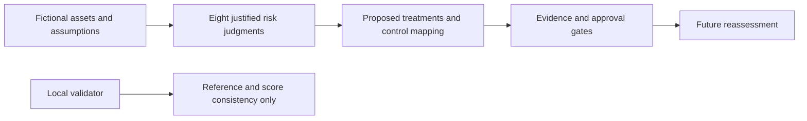

# NordicHealth: decision brief for a fictional exercise

Version reviewed 31 October 2026. No real company, patient information, organizational audit or management approval is represented.

## Scope and main decision

The invented organization has 40 staff and depends on supplier-hosted administrative services. It operates staff laptops but no datacenter or industrial/medical devices within this scope. Information categories include appointment metadata, confidential administration documents, staff identities, support cases and audit records. Appointment data could reveal sensitive circumstances even without clinical notes. The exercise does not contain records about any actual people.

Eight risks link to eight assets and eight proposed treatment packages. One risk has a critical assumed score (R01, 20); seven are high (12–16). R01, R02 and R03 also trigger the impact-5 escalation rule. This is a deliberately adverse assumption set with unevidenced existing controls, not an estimate of a real organization's current security. None of the risks is accepted or closed.

The proposed decision is to request evidence and review the first three treatment designs at T+7 days after a hypothetical approval, and the remaining five at T+30. These are exercise review windows, not completed work or deadlines accepted by staff. Prioritize credential exposure, recoverability and partner authorization because the assumed consequences are severe. Do not reduce a risk score just because a policy or remediation plan has been written.

## What the artifact demonstrates

The practical work is preparing a traceable assessment and executing checks of its structured records. The checks can find an orphaned asset reference, incorrect score, inconsistent control mapping or a false completed status. They cannot establish that a real control works, that a risk judgment is correct, or that an organization meets a standard.

## Evidence needed before implementation claims

| Decision | Necessary evidence or review |
|---|---|
| Confirm the assumed service boundaries | Actual asset/data-flow inventory, supplier responsibilities, accountable owners and dependency review |
| Approve treatment designs | Risk-owner review, feasible resource plan, acceptance criteria and privacy review where relevant |
| Claim a control is implemented | Configuration/change evidence plus representative positive and negative operating tests |
| Reassess residual exposure | Review implementation evidence, remaining gaps, scope and the original likelihood/impact reasoning |
| Accept residual risk | Explicit accountable decision, rationale, conditions and next review; no automatic acceptance from a low score |
| Use the case for ISO/GDPR assurance | Complete context-specific applicability and privacy/legal assessment; this sample does not supply them |

Read the [risk assessment](RISK-ASSESSMENT.md), [scoped applicability excerpt](SOA-EXCERPT.md), [privacy review](PRIVACY-REVIEW.md) and [review gates](REVIEW-GATES.md). The structured sources are [register.json](register.json), [treatments.json](treatments.json) and [controls.json](controls.json).
